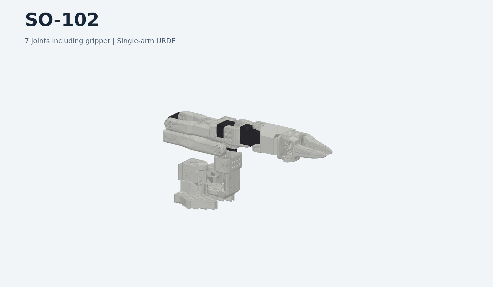
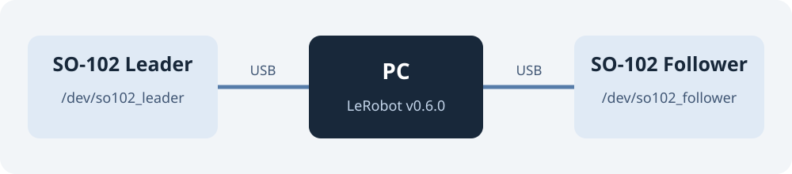
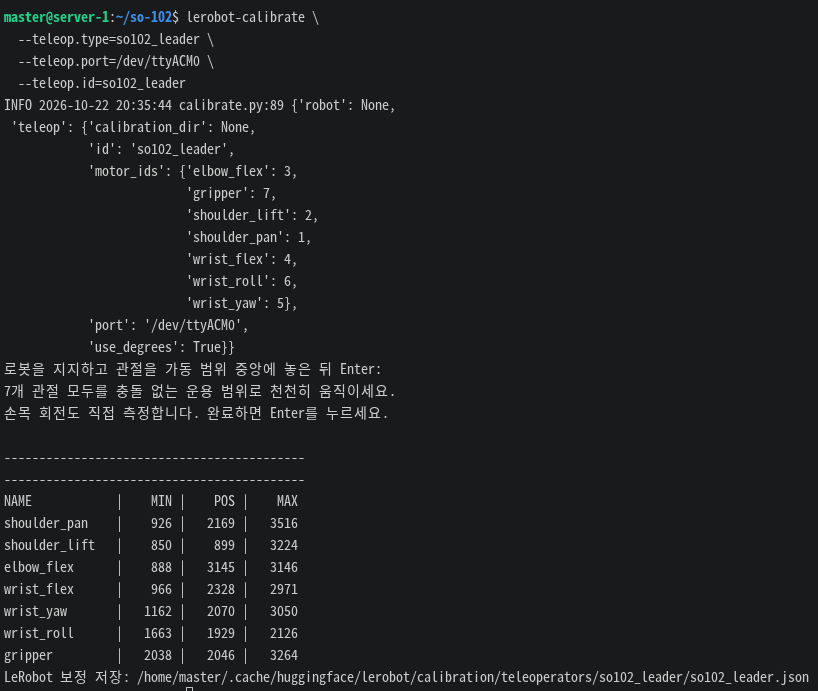
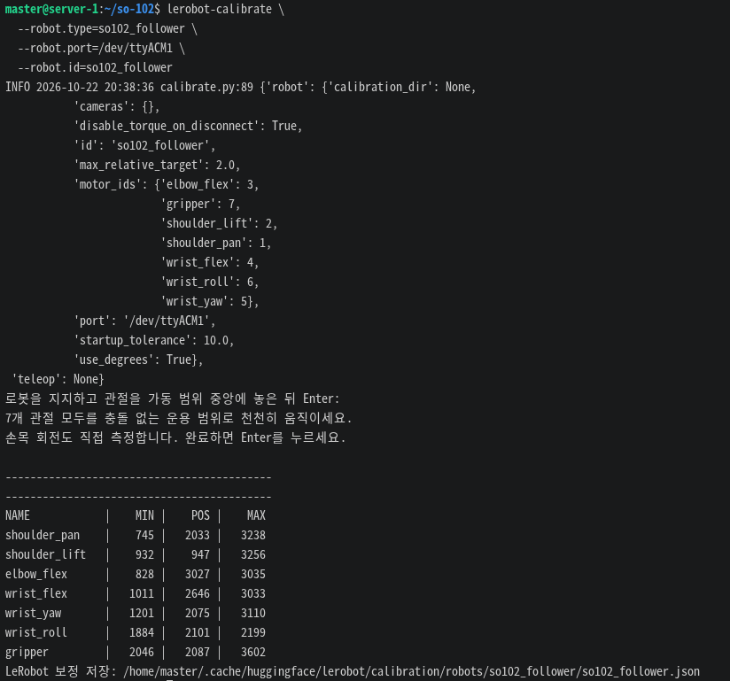

# 로보시지 SO-102 × LeRobot

기존 **LeRobot v0.6.0**에 그리퍼 포함 **7축 SO-102**를 추가하는 플러그인입니다.

## 1. 설치

처음 설치할 때는 [Miniconda부터 설치하기](<docs/1. usage.md>)를 따라 하세요.
LeRobot v0.6.0이 설치된 `lerobot` 환경에 SO-102 플러그인을 추가합니다.

```bash
conda activate lerobot
```

```bash
cd ~
git clone https://github.com/roboseasy/so-102.git
cd so-102

python -m pip install -e .

# 또는 
# pip install -e ".[so-102]"
```

위 명령어를 lerobot 라이브러리가 설치된 가상환경에 추가로 설치만 하면 바로 사용할 수 있습니다.


## 2. 연결 및 캘리브레이션



먼저 [USB 포트 고정](<docs/2. ports.md>)으로 `/dev/so102_leader`, `/dev/so102_follower`를 설정합니다.
암을 지지한 상태에서 각 명령의 안내를 따릅니다.

```bash
lerobot-calibrate \
  --teleop.type=so102_leader \
  --teleop.port=/dev/so102_leader \
  --teleop.id=so102_leader

lerobot-calibrate \
  --robot.type=so102_follower \
  --robot.port=/dev/so102_follower \
  --robot.id=so102_follower
```

포트를 고정하지 않은 경우 `/dev/ttyACM*`의 실제 장치 경로를 지정합니다.
아래 예시의 `ttyACM0`과 `ttyACM1`은 연결된 리더·팔로워의 포트에 맞게 변경하세요.

```bash
lerobot-calibrate \
  --teleop.type=so102_leader \
  --teleop.port=/dev/ttyACM0 \
  --teleop.id=so102_leader

lerobot-calibrate \
  --robot.type=so102_follower \
  --robot.port=/dev/ttyACM1 \
  --robot.id=so102_follower
```





## 3. 텔레오퍼레이션 — 카메라 없이

두 암의 자세를 맞춘 뒤 실행합니다. `Ctrl+C`로 종료합니다.
보정과 제어는 공식 SO-100/101과 같은 흐름을 사용하며, 모터 구성만 7축으로 확장합니다.

```bash
lerobot-teleoperate \
  --robot.type=so102_follower \
  --robot.port=/dev/so102_follower \
  --robot.id=so102_follower \
  --teleop.type=so102_leader \
  --teleop.port=/dev/so102_leader \
  --teleop.id=so102_leader \
  --display_data=false
```

포트를 고정하지 않은 경우 아래 예시의 `ttyACM0`과 `ttyACM1`을 실제 리더·팔로워 포트에 맞게 변경하세요.

```bash
lerobot-teleoperate \
  --robot.type=so102_follower \
  --robot.port=/dev/ttyACM1 \
  --robot.id=so102_follower \
  --teleop.type=so102_leader \
  --teleop.port=/dev/ttyACM0 \
  --teleop.id=so102_leader \
  --display_data=false
```

종료 시 기본 설정은 토크 해제이므로 암을 지지하세요.
**플러그인·공식 CLI·가상 버스 검증 완료, 실장비 구동 검증 대기.**

## 4. 데이터 레코딩

공식 `lerobot-record`에 SO-102 타입을 지정하면 7개 관절값(`observation.state`, `action`)과 카메라 영상이 함께 저장됩니다.
4~6단계는 공식 LeRobot 명령을 그대로 사용하며, SO-102 실장비 검증은 아직 진행 전입니다.

카메라 번호를 확인하고, 데이터셋 이름에 쓸 Hugging Face 아이디를 지정합니다. 업로드하지 않을 때는 임의의 이름도 됩니다.

```bash
lerobot-find-cameras opencv
export HF_USER=<Hugging Face 아이디>
```

```bash
lerobot-record \
  --robot.type=so102_follower \
  --robot.port=/dev/so102_follower \
  --robot.id=so102_follower \
  --robot.cameras="{front: {type: opencv, index_or_path: 0, width: 640, height: 480, fps: 30}}" \
  --teleop.type=so102_leader \
  --teleop.port=/dev/so102_leader \
  --teleop.id=so102_leader \
  --dataset.repo_id=${HF_USER}/so102_test \
  --dataset.single_task="Pick up the cube" \
  --dataset.num_episodes=10 \
  --dataset.episode_time_s=30 \
  --dataset.reset_time_s=10 \
  --dataset.push_to_hub=false \
  --display_data=true
```

- `--robot.id`, `--teleop.id`는 2단계 캘리브레이션에서 사용한 id와 같아야 합니다.
- 녹화 중 키보드: `→`(또는 `n`) 현재 에피소드 종료 · `←`(또는 `r`) 다시 녹화 · `Esc`(또는 `q`) 전체 종료
- 데이터는 `~/.cache/huggingface/lerobot/${HF_USER}/so102_test`에 저장됩니다. `meta/info.json`에서 `observation.state`와 `action`의 `shape`이 `[7]`인지 확인하세요.
- Hub에 올리려면 `hf auth login` 후 `--dataset.push_to_hub=true`로 녹화합니다.

## 5. 모델 학습

학습 기능은 LeRobot 폴더에서 추가로 설치합니다 ([상세 사용법](<docs/1. usage.md>) 1.10 참고).

```bash
cd ~/lerobot
pip install -e ".[training]"
```

4단계에서 녹화한 데이터셋으로 ACT 정책을 학습합니다. ACT는 데이터셋의 관절 수(7)와 카메라 구성을 자동으로 반영합니다.

```bash
lerobot-train \
  --dataset.repo_id=${HF_USER}/so102_test \
  --policy.type=act \
  --output_dir=outputs/train/act_so102_test \
  --job_name=act_so102_test \
  --policy.device=cuda \
  --policy.push_to_hub=false
```

- 로컬에 저장된 데이터셋을 먼저 사용합니다.
- 학습 결과는 `outputs/train/act_so102_test/checkpoints/last/pretrained_model`에 저장됩니다.
- 중단된 학습 이어 하기:

```bash
lerobot-train \
  --config_path=outputs/train/act_so102_test/checkpoints/last/pretrained_model/train_config.json \
  --resume=true
```

- 모델을 Hub에 올리려면 `--policy.push_to_hub=false` 대신 `--policy.repo_id=${HF_USER}/act_so102_test`를 지정합니다.
- SO-101(6축)용으로 학습된 모델은 관절 수가 달라 그대로 사용할 수 없습니다. SO-102 데이터로 학습하세요.

## 6. 모델 추론

LeRobot v0.6.0에서 `lerobot-record`는 데이터 수집 전용입니다. 학습한 정책은 `lerobot-rollout`으로 실행합니다.
5단계를 실행한 폴더에서 실행하고, 카메라 이름·해상도는 녹화할 때와 같게 맞춥니다.

```bash
lerobot-rollout \
  --strategy.type=base \
  --policy.path=outputs/train/act_so102_test/checkpoints/last/pretrained_model \
  --robot.type=so102_follower \
  --robot.port=/dev/so102_follower \
  --robot.id=so102_follower \
  --robot.cameras="{front: {type: opencv, index_or_path: 0, width: 640, height: 480, fps: 30}}" \
  --task="Pick up the cube" \
  --duration=30
```

- `--duration`은 실행 시간(초)입니다. `0`이면 종료할 때까지 계속 실행합니다.
- 처음에는 암을 지지하고 짧게 실행하세요. `Ctrl+C`로 종료합니다.
- 추론하면서 결과를 데이터셋으로 저장하려면 `--strategy.type=episodic`과 `--dataset.*` 옵션을 사용합니다 (`lerobot-rollout --help`).

[상세 사용법](<docs/1. usage.md>) · [문제 해결](<docs/3. troubleshooting.md>) · [검증 결과](<docs/5. validation.md>) · [위키독스](https://wikidocs.net/385990)
