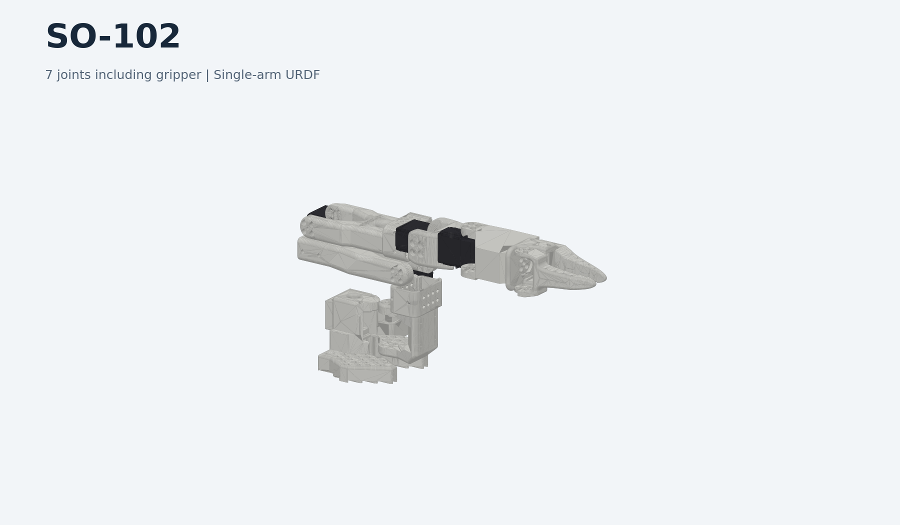
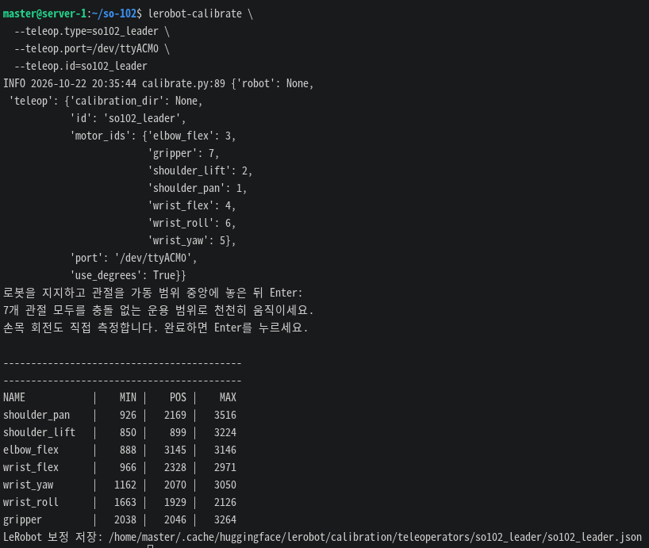
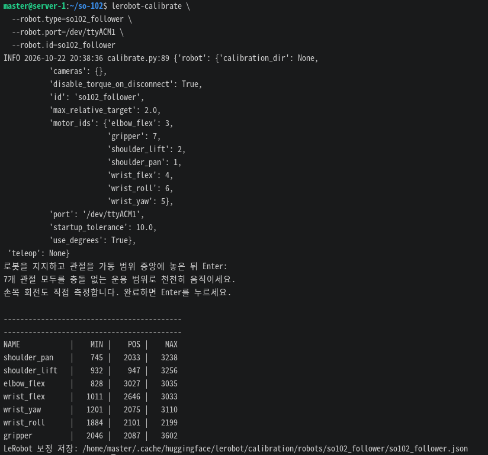

# 로보시지 SO-102 × LeRobot

기존 **LeRobot v0.6.0**에 그리퍼 포함 **7축 SO-102**를 추가하는 플러그인입니다.

## 1. 설치

처음 설치할 때는 [Miniconda부터 설치하기](<docs/1. usage.md>)를 따라 하세요.
LeRobot v0.6.0이 설치된 `lerobot060` 환경에 SO-102 플러그인을 추가합니다.

```bash
conda activate lerobot060
```

```bash
cd ~
git clone https://github.com/roboseasy/so-102.git
cd so-102

python -m pip install -e .
```

위 명령어를 lerobot 라이브러리가 설치된 가상환경에 추가로 설치만 하면 바로 사용할 수 있습니다.


## 2. 연결 및 캘리브레이션


먼저 [USB 포트 고정](<docs/2. ports.md>)으로 `/dev/so102_leader`, `/dev/so102_follower`를 설정합니다.
암을 지지한 상태에서 각 명령의 안내를 따릅니다.

```bash
lerobot-calibrate \
  --teleop.type=so102_leader \
  --teleop.port=/dev/so102_leader \
  --teleop.id=so102_leader

lerobot-calibrate \
  --robot.type=so102_follower \
  --robot.port=/dev/so102_follower \
  --robot.id=so102_follower
```

포트를 고정하지 않은 경우 `/dev/ttyACM*`의 실제 장치 경로를 지정합니다.
아래 예시의 `ttyACM0`과 `ttyACM1`은 연결된 리더·팔로워의 포트에 맞게 변경하세요.

```bash
lerobot-calibrate \
  --teleop.type=so102_leader \
  --teleop.port=/dev/ttyACM0 \
  --teleop.id=so102_leader

lerobot-calibrate \
  --robot.type=so102_follower \
  --robot.port=/dev/ttyACM1 \
  --robot.id=so102_follower
```





## 3. 텔레오퍼레이션 — 카메라 없이

두 암의 자세를 맞춘 뒤 실행합니다. `Ctrl+C`로 종료합니다.
보정과 제어는 공식 SO-100/101과 같은 흐름을 사용하며, 모터 구성만 7축으로 확장합니다.

```bash
lerobot-teleoperate \
  --robot.type=so102_follower \
  --robot.port=/dev/so102_follower \
  --robot.id=so102_follower \
  --teleop.type=so102_leader \
  --teleop.port=/dev/so102_leader \
  --teleop.id=so102_leader \
  --display_data=false
```

포트를 고정하지 않은 경우 아래 예시의 `ttyACM0`과 `ttyACM1`을 실제 리더·팔로워 포트에 맞게 변경하세요.

```bash
lerobot-teleoperate \
  --robot.type=so102_follower \
  --robot.port=/dev/ttyACM1 \
  --robot.id=so102_follower \
  --teleop.type=so102_leader \
  --teleop.port=/dev/ttyACM0 \
  --teleop.id=so102_leader \
  --display_data=false
```

종료 시 기본 설정은 토크 해제이므로 암을 지지하세요.
**플러그인·공식 CLI·가상 버스 검증 완료, 실장비 구동 검증 대기.**

[상세 사용법](<docs/1. usage.md>) · [문제 해결](<docs/3. troubleshooting.md>) · [검증 결과](<docs/5. validation.md>) · [위키독스](https://wikidocs.net/385990)
